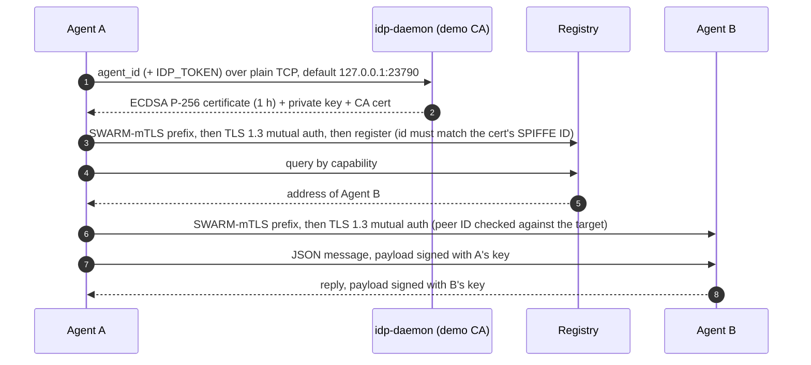

# Zero-Trust Swarm Protocol (ZTSP)

> A Go prototype of mutual-TLS messaging between AI agents: each agent proves who it is with a short-lived ECDSA certificate that carries a SPIFFE-style ID, instead of being trusted for being on the network.

**Status:** Prototype. The identity provider is a demo: it checks an allowlist and optional bootstrap tokens, not the real workload (see [Limitations](#limitations)).
**Demo:** none hosted. Run `./run-demo.sh` or `run-demo.ps1` locally (see [Quickstart](#quickstart)). CI builds the code and runs `go test -race ./...` on pushes and PRs to `main`.

[](LICENSE)

---

## Why

Agents in a multi-agent system often call each other over plain HTTP or a shared broker, so any process on the network can pretend to be any agent. ZTSP puts every agent-to-agent connection behind mutual TLS 1.3. The certificate's URI SAN (`spiffe://swarm.local/agent/<id>`) is the agent's identity. The receiver checks it, and the sender checks that it reached the agent it meant to reach.

## Architecture



| Component | Path | What it does |
| :-- | :-- | :-- |
| IdP | `cmd/idp-daemon`, `pkg/idp`, `pkg/pki` | Built-in CA. Issues 1-hour ECDSA P-256 certificates with a SPIFFE-style URI SAN to identities on its allowlist. |
| Registry | `cmd/registry`, `pkg/registry` | Capability discovery over mTLS. Rejects a registration whose agent ID differs from the caller's certificate. Serves a dashboard on `127.0.0.1:3000`. |
| Agent | `cmd/agent` | Example agent: registers, queries by capability, sends and answers tasks. |
| Sidecar | `cmd/sidecar` | Gives a non-Go agent an OpenAI-compatible HTTP API (`/v1/chat/completions`, `/v1/tasks/async`) and does the mTLS for it. |
| Transport | `pkg/transport` | TLS config, peer-ID extraction and checks, payload-signature verification. |
| Policy | `pkg/policy` | Allow/deny by principal and message type. |
| Telemetry | `pkg/telemetry` | OpenTelemetry tracer that prints spans to stdout. |
| Python SDK | `sdk/python/swarm_mtls` | HTTP client for the local sidecar. The sidecar does the mTLS, not the SDK. |
| CA init | `cmd/ca-init` | Writes a CA and agent certificates to disk (24-hour certificates). |

## Key features

- **TLS 1.3 only, client certificates required.** `MinVersion: tls.VersionTLS13` and `RequireAndVerifyClientCert` (`cmd/agent/main.go`, `cmd/registry/main.go`, `cmd/sidecar/main.go`). Go chooses the TLS 1.3 cipher suites itself; they are not configurable.
- **SPIFFE-style identity.** `spiffe://swarm.local/agent/<id>` in the URI SAN (`pkg/pki/pki.go`). A certificate must carry exactly one such SAN; there is no Common Name fallback.
- **Identity binding.** Dialers pass the expected peer ID and the connection fails on a mismatch. The registry only accepts a registration whose agent ID equals the caller's SPIFFE ID.
- **Signed payloads.** Messages carry an ECDSA signature over `Payload` only. `From`, `To`, `Type` and the trace fields are not covered by it.
- **Allowlisted issuance.** The IdP only issues IDs on its allowlist and can require a per-identity bootstrap token.

## Quickstart

Prerequisites: Go 1.25 or newer (`go.mod` says `go 1.25.0`). Docker only for the container testbed.

```bash
git clone https://github.com/HamzaKhanBUIC/Zero-Trust-Swarm-Protocol.git
cd Zero-Trust-Swarm-Protocol
go build ./cmd/...        # idp-daemon, registry, agent, sidecar, ca-init
./run-demo.sh             # PowerShell: ./run-demo.ps1
```

The demo starts the IdP, the registry and two agents on `127.0.0.1`; `agent-beta` finds `math-solver` by capability, sends it a task and prints the signed reply.

Container testbed (IdP, registry, one agent and the sidecar on a bridge network):

```bash
cp .env.example .env      # fill in the three bootstrap tokens
docker-compose up --build
```

## Configuration

There is no YAML or config file. Settings are command-line flags plus two environment variables.

| Setting | Where | Default | Description |
| :-- | :-- | :-- | :-- |
| `IDP_ALLOWLIST` / `--allowlist` | idp-daemon | empty (issues nothing) | Comma-separated identities, each `name` or `name=token`. A token must be at least 16 characters. |
| `--listen` | idp-daemon | `127.0.0.1:23790` | A non-loopback address is refused unless every allowlist entry has a token. |
| `IDP_HOST` | agent, registry, sidecar | `127.0.0.1:23790` | Where to request a certificate. |
| `IDP_TOKEN` | agent, registry, sidecar | empty | Bootstrap token for this workload's allowlist entry. |
| `--id` | agent, sidecar | agent: none; sidecar: `agent-sidecar` | Identity to request from the IdP. |
| `--listen` | agent, registry, sidecar | registry `127.0.0.1:9000`, sidecar `127.0.0.1:8080` | Listen address. |
| `--registry` | agent, sidecar | `127.0.0.1:9000` | Registry address. |
| `--caps` | agent, sidecar | empty | Capabilities to register. |
| `--target-cap`, `--task` | agent | empty | Look up an agent with this capability and send it the task. |
| `--listen-mtls`, `--upstream` | sidecar | empty, `http://127.0.0.1:5000/webhook` | mTLS listen address, and the local HTTP URL of the Python agent that receives tasks. |
| `REGISTRY_IDP_TOKEN`, `ALPHA_IDP_TOKEN`, `SIDECAR_IDP_TOKEN` | `.env` for docker-compose | none (required) | Per-workload bootstrap tokens. |

## Testing

```bash
go test ./...             # CI runs: go test -v -race ./...  (-race needs cgo)
```

Go tests live in `cmd/registry`, `pkg/idp`, `pkg/policy`, `pkg/protocol` and `pkg/transport`; other packages have none. `tests/test_python_sdk.py` covers the Python SDK.

## Architectural decisions and trade-offs

- **Built-in CA instead of SPIRE or Vault.** It keeps the demo to a few binaries. It is also why issuance is weak (see below).
- **Custom framing instead of ALPN.** Each connection starts with a plain `SWARM-mTLS\n` prefix (`pkg/transport/transport.go`), then TLS. There is no ALPN and no connection pooling: `Dial` opens a new connection per message.
- **Trace IDs in the message envelope.** `TraceID` and `SpanID` are JSON fields. They are not W3C Trace Context headers, and spans go to stdout only.

## Limitations

- **The IdP does not attest workloads.** It issues a certificate and private key to any caller that can reach its port and name an allowlisted ID. An entry without a bootstrap token can be requested by any process on the same host.
- **The IdP channel is plain TCP.** The issued private key crosses it unencrypted. On the docker-compose bridge network, other containers could read it.
- **The CA is regenerated on every IdP start** and its key is written to `.certs/ca.key` (mode 0600, unencrypted). Keys issued by `cmd/ca-init` are also written to disk.
- **Signatures cover the payload only**, not the envelope fields.
- **The sidecar HTTP API has no authentication.** Compose binds it to `127.0.0.1` only.
- **Telemetry is stdout only.** There is no OpenTelemetry Collector export.
- **Not verified here:** the docker-compose testbed and the demo scripts were not run for this README.
- **Unrelated files in the repo.** `src/`, `main.py`, `uv-install.ps1`, `examples/StressTestProject/` and the `tests/test_*.py` files other than `test_python_sdk.py` belong to a different Python project (a docs scraper and vector store). They are not part of the protocol and are not used by it.

## License

MIT. See [LICENSE](LICENSE).
